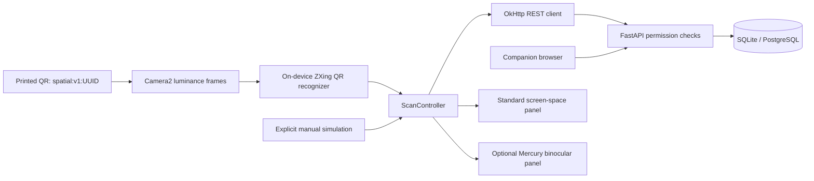

# Architecture

## Scope and implementation sequence

The primary system is persistent object identity plus authorized multi-user notes. The implementation sequence is database/authentication → permission tests → Android QR client → companion and HTTP demonstration → optional vendor adapter → device validation. SLAM is outside the baseline dependency graph.



## Object identity and annotation lifecycle

A marker is `spatial:v1:<canonical UUID>`; manually entered bare UUIDs are accepted too. The backend's `marker_id` field stores the UUID only. Physical objects have independent database UUIDs. Two identical mugs get different markers even at the same location. A copied marker represents the **same identity**: QR is an identifier, not a proof of possession or authenticity.

Camera2 enumerates YUV-capable cameras, prefers a rear-facing camera, chooses a supported resolution nearest 640×480, and copies the Y plane respecting row/pixel stride. Recognition uses ZXing `MultiFormatReader`, QR-only hints and `HybridBinarizer`. No model download, Google Play services or cloud image upload is required. Analysis is capped near four frames/second. Acquisition stops when a valid marker is detected; the user explicitly scans the next object. The lookup gate also suppresses repeated IDs for ten seconds. This avoids per-frame HTTP traffic and prevents notes from changing while being read.

Unknown markers yield 404 and a registration action. Registration assigns the backend object ID. Users create notes against that ID, with backend-generated author and UTC timestamps. Retrieval performs permission filtering **in SQL before pagination**. Notes are ordered by creation timestamp and ID, 100 per page. Clients offer refresh/load-more; they do not subscribe to changes. Refresh, sign-out, account/server changes, request failures, and activity pause clear old note state. An already displayed note cannot be remotely recalled from a user's memory; membership changes take effect at the next server request.

The companion generates QR images and supports account creation/login, object creation/editing, public location metadata, note creation/editing/deletion, group creation, owner-controlled membership addition/removal, and printing. It uses relative URLs, so API calls work through the LAN host or HTTPS reverse proxy. It inserts user text using `textContent`, never HTML. The browser keeps its session only in memory. Tabs can represent different users.

## Backend and storage

`backend/app/models.py` defines users, hashed sessions, groups, composite-key memberships, objects and annotations. UUID strings, SQLAlchemy JSON and timezone-aware DateTime types are portable to PostgreSQL. SQLite enables foreign keys and WAL; the Compose volume persists `/data/annotations.db`. There are indexes for marker uniqueness, membership/user, annotation object/time, author, visibility, group and session expiry. Database constraints enforce coordinate pairing and visibility/group consistency.

A startup lifespan calls `create_all`. This initializes an empty database; it is **not a migration system**. For schema changes, add Alembic migrations before upgrading a database containing important data. SQLite is the tested default. PostgreSQL is configurable through `postgresql+psycopg://...`; its runtime validation status is recorded in FEASIBILITY.md. Large installations should add keyset pagination and bulk author loading; this prototype's bounded list uses individual author lookups.

Sessions use 256-bit random bearer tokens; only SHA-256 token digests are stored. Passwords use Argon2id. Sessions expire after `TOKEN_TTL_HOURS` (default 24, range 1–720) and can be revoked by logout. No signing secret or real credentials are embedded. Expired session rows can be pruned periodically; they are never accepted. There is no administrator bypass, password reset, email verification, invitation flow or per-IP login throttling. This is a controlled course/demo deployment, not a hardened public identity service. For Internet exposure add gateway rate limits, monitoring, account lifecycle and operational limits.

Object metadata is intentionally public, including description, reference image URL, coordinates and location label. The UI warns about this. A reference image is an HTTPS URL stored as metadata only; the server does not fetch it. Never place confidential note text in public object metadata. Annotation text, counts and hidden author data are not embedded in object responses. Invalid requests return field locations/messages without echoing input values. Default server logs omit access logs and neither app logs credentials or annotation bodies.

## Permission rules

| Resource/action | Rule |
| --- | --- |
| Public annotation read | Anyone, including anonymous |
| Private annotation read | Its author only |
| Group annotation read | Current group member only, including the author |
| Annotation create | Signed-in user; group visibility additionally requires membership |
| Annotation edit/delete | Author, who must still be allowed to read the annotation |
| Object read / marker lookup | Public metadata |
| Object create | Signed-in user |
| Object edit | Original creator only |
| Group list | Current user's memberships only |
| Group create | Signed-in user; creator becomes owner and member |
| Membership add/remove | Group owner only; owner cannot remove themself |

Hidden annotations return the same 404 as missing annotations. Editing a visible note owned by someone else returns 403. Leaving/removal from a group also removes the author's read/edit access to that group's notes; there is no former-member bypass. Switching a note away from group visibility clears `group_id`. Switching into group visibility must supply a valid member group. Arbitrary author/timestamp fields are rejected.

## API contract

Interactive OpenAPI is at `/docs`, schema at `/openapi.json`.

| Endpoint | Purpose |
| --- | --- |
| `POST /auth/register`, `POST /auth/login`, `POST /auth/logout` | JSON credentials, issue/revoke bearer session |
| `GET /users/me` | Current account |
| `POST /groups`, `GET /groups` | Create/list memberships |
| `POST /groups/{id}/members` | Owner adds a registered username |
| `DELETE /groups/{id}/members/{user_id}` | Owner revokes membership |
| `POST /objects`, `GET /objects/{id}`, `PATCH /objects/{id}` | Stable objects; creator-controlled metadata |
| `GET /objects/by-marker/{marker_id}` | UUID marker lookup |
| `POST /annotations` | Create annotation |
| `GET /objects/{id}/annotations?limit=100&offset=0` | Authorized notes, bounded pagination |
| `GET/PATCH/DELETE /annotations/{id}` | Permission-checked individual record |
| `GET /markers/{marker_id}.png` | Printable QR, no automatic registration |
| `GET /health` | Checks database connectivity |
| `GET /` | Companion interface |

Registration/object/note/group creation returns 201; deletes/logout return 204. Authentication errors use 401, visible forbidden mutations 403, missing/hidden records 404, duplicate usernames/markers 409, and validation errors 422. All timestamps are generated by the server and serialized in UTC. Pydantic disallows unknown request fields, bounds text and metadata, and rejects nonfinite coordinates.

## Android boundaries

- `CameraCapture` / `Camera2Capture`: lifecycle-controlled frame acquisition; permission policy has independent tests.
- `ObjectRecognizer` / `QrObjectRecognizer`: real optical decoding. `SimulatedRecognizer` and manual marker UI are explicitly simulation; no markerless algorithm is claimed.
- `AnnotationRepository` / `ApiClient`: coroutine IO, timeout limits, no redirects, typed JSON responses and authorization errors.
- `AuthState` / `TokenStore`: expiration/logout behavior independent of Android. Device sessions use AES-GCM under Android Keystore; backups/device transfers are excluded.
- `ScanController`: selected object, authorized notes, navigation, request cancellation and generation checks against stale responses.
- `AnnotationRenderer`, `DeviceInput`: display/input separation. Standard native Views, keys and buttons work without vendor files; optional Mercury activity mirrors both eyes and maps temple actions.
- `LocationProvider`: manual labels/coordinates. Coordinates from the companion are saved on objects. No GPS permissions or precise indoor positioning assumptions.
- `SpatialTracker`: explicit unavailable implementation returns null, not a fake pose. Optional pose types specify meters, orientation, time and coordinate frame.

The default SDK-free APK runs on Android 8/API 26 or newer. The X3 firmware's treatment of ordinary Android windows needs hardware validation. Its normal settings/text-entry forms are intended for a phone/emulator or mirrored ADB interaction; the optional Mercury viewer is optimized for binocular reading and temple gestures. The standard app's long text is scrollable and has a full-text details dialog.

## Spatial coordinates and extension boundary

QR decoding identifies objects; it does **not** estimate a calibrated pose. No world-space transform or persistent anchor is fabricated. The default display is screen-space; the optional Mercury panel is head-locked. Stored `spatial_anchor`/`spatial_metadata` are bounded JSON extension fields, not promises of tracking support.

For a future calibrated marker renderer, define `T_A_B` as mapping coordinates from frame B into A. With synchronized capture and tracking:

`T_world_object(t) = T_world_head(t) × T_head_camera × T_camera_object(t)`.

A PnP marker estimate requires known marker side length, camera intrinsics/distortion, correct camera orientation, and a camera-to-head extrinsic calibration. OpenCV camera convention (x right, y down, z forward) differs from typical OpenXR views (x right, y up, -z forward); conversions must be explicit and tested against the runtime's documented reference space. Use the image capture timestamp and interpolate head pose from the same monotonic time domain; a render-time pose cannot replace the capture-time pose. Vendor timestamp reliability must be measured.

On invalid tracking, hide world-locked content and show the head-locked panel. Do not freeze a stale transform and claim it is tracked. Persistent world anchoring needs map/anchor storage, relocalization, reference-frame continuity and accuracy measurements across restarts and devices. Those are not implemented. QR re-identification persists because the server maps the printed ID to notes, not because a SLAM map persists.

## Deployment and HTTPS

Development Compose binds `0.0.0.0:${BACKEND_PORT:-8000}`. Check the port first; 5173 is reserved for another project. The Android URL is user-configured and never defaults to localhost. The debug application permits cleartext at Android's transport layer, but `ServerAddress` restricts HTTP to private IPv4 ranges (10/8, 172.16/12, 192.168/16), disallows embedded credentials/query/path, and OkHttp rejects redirects. This is a deliberate LAN-development exception; password and bearer confidentiality require HTTPS even on Wi-Fi.

Release builds set cleartext traffic to false and require HTTPS. They retain normal system certificate and hostname validation; no trust-all TLS handler is installed. Use a real trusted certificate or install a deliberately managed test CA on the device rather than disabling validation.

For a hostname you control, the optional Caddy override removes the backend's published HTTP port:

```bash
# Check ports 80 and 443 first; configure DNS and firewall for this host.
export SITE_ADDRESS=notes.example.org
docker compose -f docker-compose.yml -f docker-compose.https.yml up -d --build
```

Use current Compose V2 with [`!reset` override support](https://docs.docker.com/reference/compose-file/merge/). The override's configuration was validated; certificate issuance is not tested without a real hostname. Caddy binds all interfaces, limits request bodies to 1 MB and persists certificates. Set the glasses URL to `https://notes.example.org`. Keep `.env` outside version control. Back up the SQLite database using SQLite's backup API or stop the backend before copying database/WAL files. Do not use `docker compose down -v` when preserving demo data.
