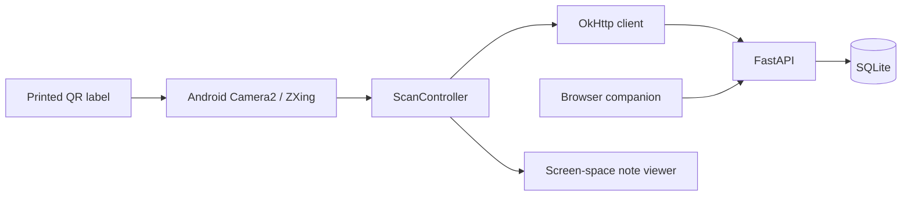

# Architecture

## Data flow



A label contains `spatial:v1:<UUID>`. The backend stores the marker UUID separately
from the object's database ID. Different labels distinguish visually identical
objects; copying a label copies its identity.

Camera2 supplies YUV frames to the local ZXing decoder. The app selects a supported
size near 1280×960, analyzes about four frames per second, and stops on a valid
marker. `ScanController` handles lookup, pagination, navigation, and cancellation
of stale requests. An unknown marker can be registered. Manual marker entry is
available for simulation and backend diagnostics.

The companion uses relative API URLs and renders user content with `textContent`.
It handles typing, object registration, note editing, group membership, and QR
printing. Clients refresh explicitly; membership changes apply on the next request.

## Storage and permissions

SQLAlchemy models cover users, sessions, groups, memberships, objects, and notes.
SQLite uses foreign keys and WAL. The schema is created on startup with `create_all`;
there is no migration system. PostgreSQL can be configured with a
`postgresql+psycopg://...` URL, but the test suite runs against SQLite.

Passwords use Argon2id. Bearer tokens are random, stored as SHA-256 digests, and
expire after `TOKEN_TTL_HOURS` (24 by default). Android stores sessions using Android
Keystore encryption; the browser keeps them in memory.

| Action | Access |
| --- | --- |
| Read object metadata | Anyone |
| Create / edit object | Signed-in user / original creator |
| Read public note | Anyone |
| Read private note | Author |
| Read group note | Current group member, including the author |
| Create note | Signed-in user; group notes require membership |
| Edit / delete note | Author, with current read access |
| Manage group membership | Group owner |

Permission filters run in SQL before pagination. Hidden notes return 404; editing
another author's visible note returns 403. Object metadata, including location, is
public. Notes contain server-generated author and timestamp fields. Request schemas
reject unknown fields and invalid coordinates. The API reference is served at
`/docs`, with its generated schema at `/openapi.json`.

## Android and RayNeo

The standard app uses native Android views and Camera2 with no vendor SDK.
`AnnotationRenderer` and `DeviceInput` are shared by the standard and optional
Mercury viewers. The latter mirrors a head-locked panel to both eyes and maps temple
gestures. Build selection and SDK installation are in [RayNeo setup](RAYNEO_SETUP.md).

QR decoding supplies identity, not pose. There is no head tracking, world-space
renderer, or persistent spatial anchor implementation. Stored spatial metadata is
an extension field. See [research references](RESEARCH.md) for earlier tracking work.

## Deployment

Compose binds `0.0.0.0:${BACKEND_PORT:-8000}` and persists SQLite in a named volume.
Check the port before starting; port 5173 is reserved for Rakazo. The Android server
URL is user-configured. Debug builds accept HTTP on private IPv4 addresses and
`127.0.0.1` for ADB reverse. Release builds require HTTPS. OkHttp rejects redirects;
normal TLS certificate validation remains enabled.

For a hostname you control, check ports 80/443, configure DNS, then run:

```bash
export SITE_ADDRESS=notes.example.org
docker compose -f docker-compose.yml -f docker-compose.https.yml up -d --build
```

The override uses Compose V2 `!reset` support to remove the direct backend port.
Caddy publishes 80/443 on all interfaces, limits request bodies to 1 MB, and stores
certificates in named volumes. Certificate issuance requires reachable DNS/ports.

Keep `.env`, credentials, and SDK binaries local. Back up SQLite through its backup
API or stop the service before copying the database and WAL files. `docker compose
down -v` deletes the data volume. The prototype has no password recovery, login rate
limiter, or schema migrations; account for those before a public deployment.
