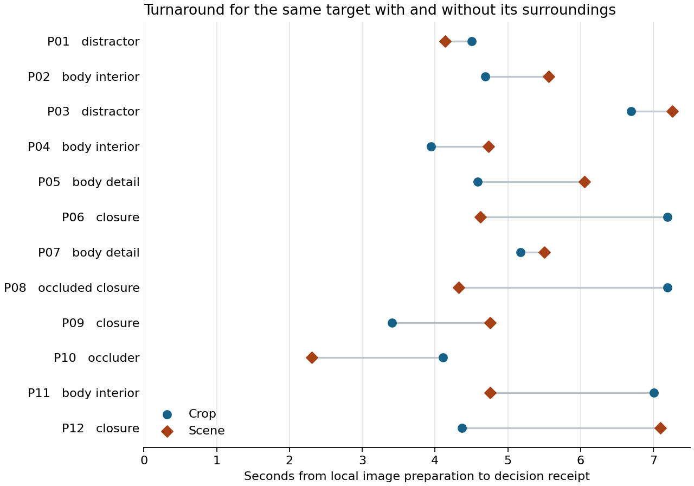

# How long did one object-label decision take?

On November 24 we timed **24 actual conversational vision decisions** on four archived RayNeo photos. Giving the reviewer the full scene recovered three additional bottle labels. The full-scene decisions reached the recorder in a median **4.75 seconds**, compared with **4.64 seconds** for a crop. In the earlier physical experiment the median capture-to-display-commit interval was **13.43 seconds**. These timings have different start and end points.

| Timed replay · one region per decision | Crop + references | Full grayscale scene + references |
|---|---:|---:|
| Correct bottle labels / 9 target regions | 6/9 | 9/9 |
| Wrong bottle labels / withheld on a bottle | 0 / 3 | 0 / 0 |
| Background regions left unlabeled | 3/3 | 3/3 |
| Preparation start → decision receipt, median (range), 12 reads | 4.64 s (3.41–7.19) | 4.75 s (2.31–7.26) |
| Prepared image → decision receipt, median | 4.64 s | 4.75 s |
| Local image preparation, median | 2.01 ms | 3.47 ms |
| Local worker CPU time per decision, median | 2.14 ms | 3.62 ms |
| Local worker resident memory at image-ready, median | 31.26 MiB | 31.13 MiB |
| Prepared JPEG including references, median | 10.92 KiB | 63.85 KiB |
| Correct bottle labels received within 5 s / 9 targets | 3/9 | 5/9 |

The wider image was **5.85×** as large in encoded bytes. The median *within-target* change in turnaround was **+0.45 s** (range **−2.86 to +2.73 s**). The difference between the two column medians is a separate statistic. The small, variable sample cannot resolve an inference-speed difference. Five seconds is a retrospective example deadline. The application should measure how long the wearer actually keeps a target in view.



### What we measured

* **One actual decision per image.** One persistent Linux worker decoded the archived JPEG, prepared a grayscale crop or outlined scene beside the same two color enrollment references, encoded the card, and calculated its SHA-256. On each trial the assistant viewed that exact card and returned A, B or unknown. The recorder stopped its host monotonic clock on receipt. Six probes drew crop first and six drew scene first. The second view of each probe was presented in a later shuffled block. No decisions from the first experiment were fed into the recorder.
* **Interpretation.** Both reads were in the same ongoing conversation. The photos, task and earlier decisions were familiar. There were 12 reused regions and four photographs, no independent test sequences. The reviewer judged the surface indicated by the box, including the cap in the closed two-bottle gallery. The time includes image tools, conversation scheduling, review and submitting a short answer. A new glasses capture, annotation lookup and display refresh were outside this pass.
* **Resources.** Process CPU includes all worker threads between the two host boundaries. RSS is Linux VmRSS at image-ready in a shared Python process. Consecutive trials reuse its allocator. The raw OS ru_maxrss value was already 670 MiB on the first trial and can carry across exec on this launcher. We exclude it from the memory estimate. JPEG bytes measure the local file. Tool re-encoding, actual network bytes, inference tokens, provider GPU/CPU/RAM, cost and energy were unavailable. The current conversation exposed no dedicated timed provider configuration.
* **No timed reads dropped.** All 24 decisions reached the recorder. The saved key identifies the region's originating surface. P95 is withheld for 12 observations per mode. All times use one monotonic host clock within each trial. [Raw decisions and timings](reviews.csv) · [Environment](environment.json) · [Summary](summary.json)

### How much did the inexpensive matcher use?

With the reference gallery already encoded, each CPU update decoded one source JPEG, extracted two manually boxed bottles, computed the existing color-grid descriptors, and ranked both references. On an Intel Core i7-10700, Linux x86-64, NumPy 2.2.6, one OpenBLAS thread, **100 warm updates** took **1.60 ms median, 1.65 ms P95**. Median process CPU was **1.60 ms**, and after-update resident memory was **37.33 MiB**. The two clear post-swap photographs were each repeated 50 times for timing. The matcher chose A for both bodies, giving **2 correct identities out of 4 distinct body views**. Those repeats do not supply 200 independent accuracy observations. The result excludes camera capture, detection, track management, HTTP and rendering. [Local samples](appearance.csv) · [Boxes and original scores](../clear-swap.csv)

### What the wearer experienced in the physical pilot

Across six completed snapshot trials on November 19, **capture request → Android frame commit observed** took **13.43 s median** (10.15–15.83 s). Median **review including tools** was **10.42 s**. Once a response was received, the host observed the device commit a median **184 ms** later. There were also three failed attempts, including a rejected stale response. The new offline review times cannot substitute for a stage in this historical total.

The median **per-trial sampled peak** was **154.18 MiB** for the Android app (range 152.77–156.80 MiB) and **51.59 MiB** for the Python USB bench. The median observed Android CPU delta was **0.195 CPU-seconds** and median per-trial average load was **0.57% of one core**. The sampling interval was approximately 0.5 s. The measurement window includes idle display hold and can miss early cold-start work. These values describe the app, not total glasses power or remote model resources. [Physical trial data](../../../codex-glasses/2026-11-19/report/trials.csv) · [Per-phase resource samples summarized](../../../codex-glasses/2026-11-19/report/phase-resources.csv)

### Reproduce and use the result

Run from the repository root with the project Python environment on Linux.

```bash
D=experiments/context-labels/2026-11-24/usability
.venv/bin/python "$D/summarize.py" --verify-inputs   # Rebuild all cards and verify timings
.venv/bin/python "$D/plot.py"                       # Rebuild the paired figure
# Fresh run: open each input.jpg printed on stdout, then enter its trial number and A/B/unknown
RUN="artifacts/context-labels/usability-$(date -u +%Y%m%dT%H%M%SZ)"
.venv/bin/python "$D/measure.py" --out "$RUN"
OPENBLAS_NUM_THREADS=1 .venv/bin/python "$D/appearance_bench.py" > "$RUN/appearance.csv"
.venv/bin/python "$D/summarize.py" --verify-inputs --data "$RUN"
```

Use the fast local path for routine updates. At an ambiguity event, test a scene-aware VLM call in the background. **Correct before the view changes** is the next usability measure. Record the first ambiguity, next viewpoint/track change, model request and receipt, device commit, and wearer selection. Count wrong, late, and withheld notes separately. For provider costs and sustained device power, retain provider usage plus synchronized baseline and active power readings on the named hardware. [Glasses session protocol](../../../../docs/CONTEXT_LABEL_GLASSES_SESSION.md)
