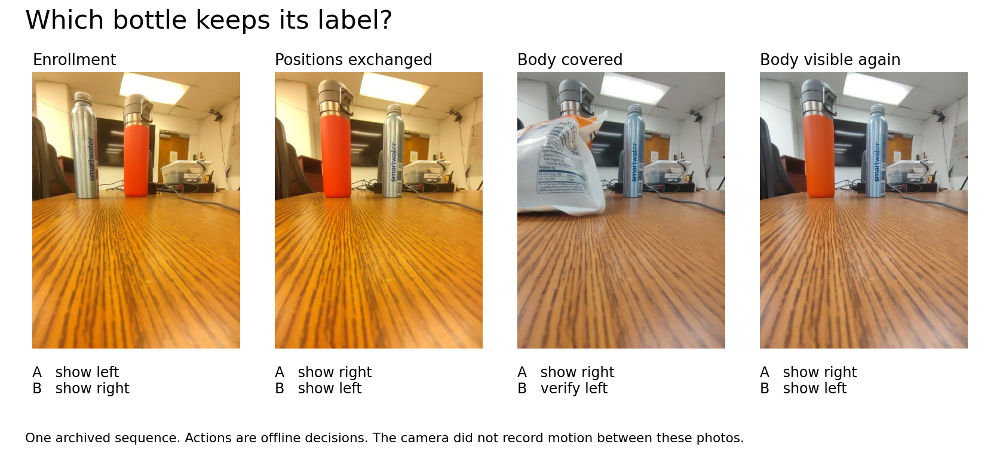

# Does an earlier view change the label?

**Presentation summary.** Codex reviewed all 12 archived RayNeo photographs. Eight had a preceding photo in the same run. Supplying that photo changed **0 of 8** paired scene decisions. Both inputs placed the labels on the new sides after the swap, withheld B’s note when the bag hid its body, and restored B’s note on the reveal. The earlier view added a median **0.31 seconds per paired decision**. This archive offers little evidence for spending an extra image on every call. It leaves open whether recent continuous views can resolve harder, same-model cases.



### What was judged

Each decision covered **both bottles**. The model proposed a candidate side and reported body evidence, part-only evidence, or no identifiable candidate. A fixed policy translated these into show the note, show a neutral verification state, or clear the label. The time to reach an offline action includes writing a short evidence statement. The reads ran in the ongoing conversational vision session using the same gallery. Twelve distinct source photos produced four unpaired run starts and sixteen paired reads. One start was the enrollment image. All 20 attempts completed, including reads of source photos whose historical delivery had failed.

| Paired replay · medians across 8 decisions per mode | Current + enrollment | Current + enrollment + earlier photo |
|---|---:|---:|
| Preparation start through offline label action | 4.42 s | 4.67 s |
| Observed range | 3.57–8.97 s | 3.77–7.86 s |
| Prepared card through response receipt | 4.42 s | 4.66 s |
| Image preparation and hashing | 4.45 ms | 7.32 ms |
| Response validation and action calculation¹ | 0.068 ms | 0.069 ms |
| Local recorder CPU time | 4.62 ms | 7.50 ms |
| Worker resident memory after decision | 33.48 MiB | 33.48 MiB |
| Prepared JPEG size | 74.15 KiB | 137.54 KiB |
| Offline actions across 16 object slots | 11 show, 1 verify, 4 clear | 11 show, 1 verify, 4 clear |

¹ Includes response parsing and local record assembly. Process high-water resident memory from Linux VmHWM was **34.48 MiB** across the run. Per-frame changes in latency ranged from **−3.40 to +2.92 seconds**. JPEG size grew **1.85×**. Bytes describe the prepared image on disk. CPU and memory describe the local Python recorder on the i7-10700. The tools did not expose provider tokens, model revision, GPU resources, isolated inference time or energy. This replay did not drive the glasses, time authorization or measure optical display latency. In the separate physical pilot, six completed trials took **13.43 s median** from host capture request to observed Android frame commit; the glasses app’s median sampled peak was **154.18 MiB**. [Physical measurements](../2026-11-24/usability/README.md)

### Read the decisions

| Event | Current visible evidence | What the earlier view contributed | Result in both reads |
|---|---|---|---|
| Positions exchanged | Silver lettered bottle on the right. Orange hinged-lid bottle on the left. | Shows their former sides were reversed. | Show A on the right and B on the left. |
| B covered by a bag | Hinge and collar project above the bag. A’s branded body is visible. | B’s orange body was visible below that cap 159 s earlier. Movement or substitution during the gap is unobserved. | Show A. Propose B on the left and withhold its note. |
| B uncovered | The orange body is now visibly attached to the hinged closure. | Earlier picture shows the body concealed in that area. | Restore B’s note on the left. |
| Camera turned toward a laptop | Neither enrolled body can be identified. | An older image still contains both bottles. | Clear both labels, including on the orange packaging. |

The per-read log links to the actual inputs and records each visible cue, identity proposal, side, label action, latency, CPU time, memory and JPEG size. The raw log also preserves monotonic timestamps, failure status and input hashes. [All 20 reads](decision-log.md) · [Raw JSONL](events.jsonl) · [Summary JSON](summary.json) · [Environment](environment.json) · [Procedure fixed before the run](protocol.md)

**Interpretation.** All 16 object slots per paired mode agreed with the archived reviewer’s action and relative side. Agreement with a previous model review cannot establish physical ground truth. The same conversation knew these photos, so removing the earlier picture from the card does not erase its conversational context. Each method saw one genuine covered-bottle snapshot, and the two bottles had different finishes and closures. The protected identity is the body. Calling the visible cap a plausible B and withholding the body-specific note is consistent with the earlier crop task identifying the cap. The effect of moving or substituting the body *while hidden* still needs a physical test. [Next judge study](../../../docs/VLM_LABEL_JUDGE_STUDY.md)

### Reproduce

From the repository root using the project Linux Python environment:

```bash
D=experiments/context-labels/temporal-judge
.venv/bin/python "$D/report.py" --out artifacts/temporal-judge-verified
diff "$D/summary.json" artifacts/temporal-judge-verified/summary.json
diff "$D/decision-log.md" artifacts/temporal-judge-verified/decision-log.md
.venv/bin/python "$D/figure.py"
```

For a new interactive review run `.venv/bin/python "$D/replay.py" --out artifacts/temporal-judge-new` with an unused output directory. Inspect each printed card. Submit a single JSON line with its trial number, proposals A and B as arrays of support, side and short observable evidence, and a brief context observation. Use the statuses in the protocol. Then run the report with `--run artifacts/temporal-judge-new --out artifacts/temporal-judge-new`. No network service or model call is started by the recorder.
